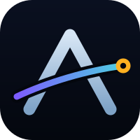
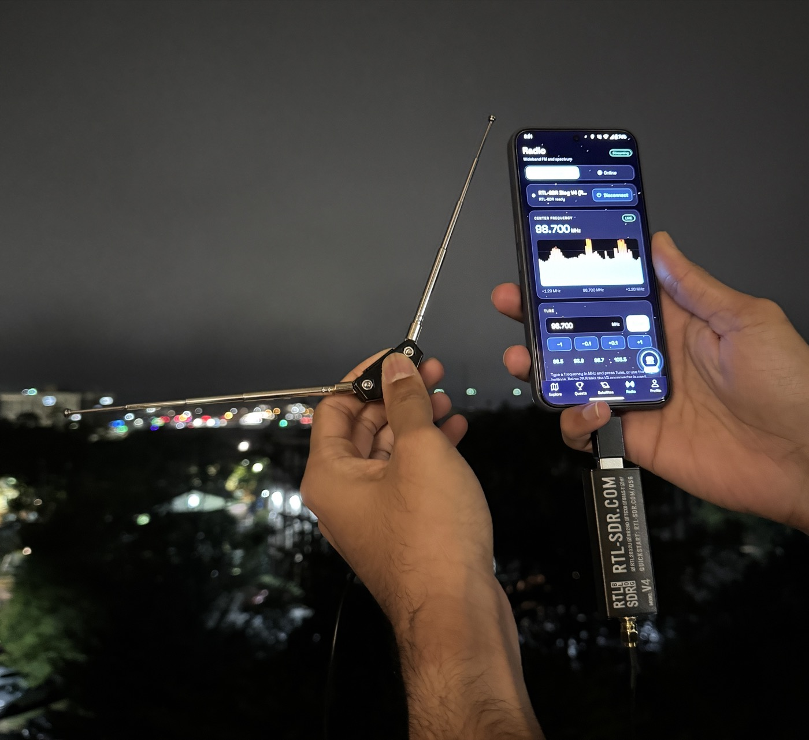

<p align="center">
  
</p>

<h1 align="center">Azimuth</h1>

<p align="center"><b>Map the world. Get paid for it.</b><br>A decentralized satellite ground station and coverage network that lives in a Solana Seeker phone.</p>

<p align="center">
  <a href="https://www.loom.com/share/52b807d557944b8da304b7e39e465274">Demo video</a> ·
  <a href="https://drive.google.com/file/d/1Hbc5a72XcJw3o8reSlotrZtVxCtY8oS_/view?usp=sharing">Pitch slides</a> ·
  <a href="#live-contracts-solana-devnet">Live contracts</a> ·
  <a href="#how-reports-are-verified">How reports are verified</a>
</p>

## About

Azimuth turns a phone into a sensor, a wallet and, with a small radio dongle, a satellite ground station.

- **Map signal coverage.** Turn on mapping and walk. The app records cellular, Wi-Fi, Bluetooth and (with a dongle) radio signal strength, and clears a fog-of-war map as you cover new ground. Dead spots show up on the map.
- **Get paid in AZM.** You sign each session with your Seeker's Seed Vault. A verifier checks it, and approved work is paid in the **AZM** token on Solana. Quests, bounty chests and treasure chests add more rewards.
- **Receive satellites.** With an RTL-SDR dongle the app predicts Meteor-M weather-satellite passes, tracks radiosondes, plays FM radio and records satellite passes you can turn into weather images.

Why a phone: coverage data is gathered by a few companies, locked behind them and paid to almost nobody. A ground station costs on the order of $100K to build, which keeps small teams and communities out. Azimuth spreads that work across many cheap receivers and pays the people who do it. The phone is the sensor and the wallet; the Seeker's Seed Vault and `.skr` name give each contributor a real identity.

Azimuth grew out of an earlier Azimuth satellite ground station project. This repository is the mobile app, its verification server and the on-chain reward program.

### Screens

| Tab | What it does |
|-----|--------------|
| **Explore** (home) | A street map covered in fog, with Cellular, Wi-Fi, Bluetooth, Radio and Sondes layers. Turn on mapping and walk: the fog clears where you go. Open chests appear on the map; the nearest one shows as an arrow and distance, and close up you can find it in **AR** and open it. Swipe up the sheet for live stats and to sign and submit a session. |
| **Quests** | Daily and weekly goals that pay AZM when claimed. |
| **Satellites** | Next Meteor-M passes (peak elevation, direction, quality, countdown), reminders, per-pass ground track and sky view, and a **Capture** button. A second tab tracks radiosondes. |
| **Radio** | Connect the dongle, tune 0.5 MHz to 1.766 GHz, live spectrum and FM audio. An Online mode works without a dongle. |
| **Profile** | Wallet, Seeker check, AZM balance and earnings, privacy and data deletion, plus Recordings and Settings. |

## Hardware setup

A Seeker phone, an OTG adapter and an RTL-SDR Blog V4 with a telescopic antenna. The Radio tab shows the live spectrum from the dongle.

<p align="center"></p>

## Live contracts (Solana devnet)

| What | Address |
|------|---------|
| Registry program (`azimuth_registry`) | [`AJtmjGMQPjPUF5zscYXdMqvMXgRYZHeWHgNijAEae9Zh`](https://explorer.solana.com/address/AJtmjGMQPjPUF5zscYXdMqvMXgRYZHeWHgNijAEae9Zh?cluster=devnet) |
| AZM token mint (0 decimals) | [`J2GWTK6eYacXU45DJzsCYrVotftyaG5F6fo1z9AyJg9H`](https://explorer.solana.com/address/J2GWTK6eYacXU45DJzsCYrVotftyaG5F6fo1z9AyJg9H?cluster=devnet) |
| Program config | [`8tGhCf8RbNvgwzVxtf196juTSfyu9uHSDTMhqTWXyKrV`](https://explorer.solana.com/address/8tGhCf8RbNvgwzVxtf196juTSfyu9uHSDTMhqTWXyKrV?cluster=devnet) |
| Reward vault | [`5WWETEbsUHTne8FTJsSxAYQgr8aZFQdrcyhX2XCWJ5Rf`](https://explorer.solana.com/address/5WWETEbsUHTne8FTJsSxAYQgr8aZFQdrcyhX2XCWJ5Rf?cluster=devnet) |
| Authority (the only signer that can pay) | [`qq45wBYoZwKfQ7kkidp6CGAuK4A17SFkvQCzcg9YWBC`](https://explorer.solana.com/address/qq45wBYoZwKfQ7kkidp6CGAuK4A17SFkvQCzcg9YWBC?cluster=devnet) |

These are **devnet** addresses; AZM has no real-world value yet. The same values are in `onchain/devnet.json`. The program source is in `onchain/programs/azimuth_registry`.

## How reports are verified

Nobody has to be trusted to be honest. A report earns AZM only after several independent checks, and the weakest links are listed below.

**What a report is.** A mapping session, chest claim or satellite pass is turned into canonical JSON, hashed with SHA-256, and signed with the contributor's wallet key through Seed Vault. The signing key never leaves the phone.

**What is checked, in order**

1. **Signature and hash.** The server recomputes the hash and checks the ed25519 signature against the wallet address in the report. A second verifier (`server/lib/verify-report.cjs`) shares no code with the app, so anyone can check a report independently: `node server/lib/verify-report.cjs report.json`.
2. **Identity.** The wallet can be required to hold a **Seeker Genesis Token**, with each token allowed to serve only one wallet, to limit one person running many accounts. This gate is switched on with `REQUIRE_SEEKER=1` on the server; it is **off by default** during the hackathon so the app can be tried on any wallet.
3. **Location and motion (GPS).** On the phone, fixes are dropped if there is no fix, the fix is stale or inaccurate, Android flags it as a mock location, or the speed is not plausible. The session records how many mocked fixes it saw, and the server rejects any session that saw one, or one that peaked above 70 m/s, lasted under 30 seconds, or claims more readings than its length allows.
4. **Sensor-log plausibility.** Readings are kept in 15-minute buckets per map cell. The server rejects signal levels that are not physical (for example cellular outside -140 to -30 dBm), min/mean/max values that contradict each other, more Wi-Fi or Bluetooth readings than samples, duplicate cell-and-time entries, reports older than 72 hours or from the future, and sonde or radio levels outside what the hardware can produce.
5. **Satellite passes.** The pass window, frequency band (137 MHz), recording size and sample count must agree, and the claimed peak elevation must match what the satellite's orbital data predicts for that place and time (within 12 degrees).
6. **Chest claims.** The report must contain enough of the right kind of readings in the chest's cell or the cells next to it, taken after the chest was created, and a chest can only be filled up to its limit.
7. **Settlement.** Every check above runs automatically on the server, with no person involved, and a report that fails any of them cannot be paid. **Challenge claims** (daily and weekly quests) go all the way through automatically: the server checks the claim against work it already counts and pays AZM through the contract within seconds. For **mapping, satellite and chest reports** the same automatic checks decide whether a report can be approved, and a person then presses Approve in the admin portal to release the AZM payout. That person is the point of manual intervention, for example to hold back a report that looks suspicious or to retry a payout that failed on-chain.

**What stops replay and fake reports**

- **Same report twice.** The report hash is unique. A repeat is refused by the server, and on chain the payout record is created at an address derived from the wallet and the report hash, so a second payout for the same report fails.
- **Same quest twice.** A challenge can be claimed once per wallet per period (daily or weekly). The on-chain hash is derived from the challenge and the period.
- **Walking the same ground again.** A map cell pays only the first time anyone reports it, and each wallet has a daily cap on paid new cells. For quests, only the best of several overlapping reports counts.
- **Old or future reports.** Reports must be recent and not dated in the future.
- **Floods.** There is a limit on reports per wallet per hour.
- **Overpaying.** The on-chain program rejects any single payout above its cap (100 AZM), a payout of zero, an unknown reward type, and any payout while rewards are paused. Only the authority key can pay, and rewards come only from the fixed reward vault.

**What is not proven.** The server cannot prove that a radio, Wi-Fi or cellular reading is real. The checks make cheap fabrication fail and make consistent fabrication costly, and the admin review is the backstop. A determined attacker with a rooted device could still feed fake GPS that Android does not flag. Devices are not attested, and the Seeker gate is optional. These are the next hardening steps, together with moving payouts to mainnet.

## Status

Built and verified without hardware in the loop: the full app compiles for Android (debug APK builds), the JavaScript bundles with Hermes, 180+ unit tests and 470+ native DSP checks pass, and the pass predictor matches an independent implementation (Skyfield) to under a second on all 12 passes in a 48 hour comparison.

**Not yet verified on a real satellite pass.** FM reception, the spectrum and the USB driver were confirmed on a real V4. Satellite capture needs a real overhead pass and a suitable antenna. See [Known limitations](#known-limitations).

## Screens

| Tab | What it does |
|-----|--------------|
| **Map** (home) | A real street map covered in fog. Turn on mapping and walk: the fog clears where you go (only while mapping is on). While mapping is on, open chests appear on the map; the nearest one shows as an arrow and distance at the top, and within 60 m you can find it in **AR**: the camera shows a 3D chest where it really is, and you tap it to open it. Swipe up the mapping sheet from the bottom for live stats, and to sign and submit a session. |
| **Profile** | Wallet, Seeker check, earnings, privacy and data deletion, plus links to Recordings and Settings. |
| **Radio** | Connect the dongle, tune any frequency 0.5 MHz to 1.766 GHz (HF via the V4 upconverter), live spectrum, mono wideband-FM audio with volume. |
| **Satellites** | Next passes for M2-3 and M2-4 (peak elevation, direction, quality, countdown), reminders, and per-pass detail: ground-track map with coverage footprint, polar sky plot, a time scrubber, and a **Capture** button. |
| **Recordings** (in Profile) | Saved passes with size, duration, peak elevation and gap count. Share, export to Downloads, or delete. |
| **Settings** (in Profile) | Location (GPS or manual), minimum pass elevation, reminders, orbital-data status, storage. |

## Hardware

- Android 7+ phone with USB host (OTG), plus an OTG adapter
- RTL-SDR Blog V4 (RTL2832U + R828D). Other RTL2832U dongles should work for Radio.
- For satellites: a **137 MHz antenna** with a clear view of the sky, outdoors if you can. A V-dipole (two 53 cm elements at 120 degrees, pointing at the sky) is the usual starter; a QFH is better. The short telescopic FM whip is not suitable. An LNA powered through the V4 **bias-tee** helps on weak passes (the toggle is on the capture screen).

## Setup and run

Requirements: Node 20+, JDK 17 or 21, Android SDK with an NDK (r26/r27) and CMake 3.22.1, `ANDROID_HOME` set.

```bash
npm install
npx expo run:android      # builds and installs a development build
npm start                 # later: just start Metro
```

This needs a **development build**, not Expo Go (it contains a local native module).

The dongle uses the phone's only USB port, so you cannot also have `adb` over USB. Use wireless debugging (Settings > Developer options > Wireless debugging), then `adb connect <ip>:<port>` and `adb reverse tcp:8081 tcp:8081` so the app can reach Metro. Alternatively install a release build, which bundles its JavaScript:

```bash
npx expo run:android --variant release
```

Logs: `adb logcat -s RtlSdrJni librtlsdr RtlSdrModule`.

## Recording a pass

1. Open **Satellites**, tap a pass, and check the sky plot and quality. Passes above about 30 degrees decode best.
2. The **Capture** button becomes available 5 minutes before the pass. Open it.
3. If the receiver is not connected, the big button at the top says **Connect receiver**. Plug the dongle in with the OTG cable and tap it.
4. The app now sets itself up (see below). You do not choose a frequency, gain or bias-tee.
5. Tap **Start recording**, ideally a minute or two before the satellite rises. It runs as an Android foreground service, so it continues with the screen off, and it stops itself shortly after the satellite sets. You can stop earlier; the part recorded is saved.

Capture is manual: nothing starts by itself.

### Automatic set-up

As soon as the receiver is connected the capture screen runs a short calibration, shown as a checklist, and then keeps watching:

1. **Frequency.** The receiver is tuned between 137.1 and 137.9 MHz, which puts both downlinks in view at once, and an LRPT-shaped block (a flat-topped signal about 140 kHz wide with a clear drop on both sides) is looked for on each. If one shows it, that frequency is used. Otherwise the app uses the one SatNOGS observations say is working (see below), then 137.900 MHz.
2. **Gain.** About eight manual gain steps between 20 and 44 dB are tried, measuring the raw sample level, overload (clipping) and the signal at each. The app picks the best signal if one is visible, otherwise the **lowest gain at which the 8-bit converter's rounding noise is negligible**, never one that clips, and never the maximum. When a real signal later appears, the gain is fine-tuned on it once.
3. **During the recording** the gain is only ever *lowered*, one step at a time, if the receiver starts to overload. Any change is written to the metadata.

The tuner's own automatic gain is deliberately **not** used: experienced operators report that it distorts the narrow LRPT signal, so the app always applies a fixed manual gain.

**Antenna power (bias-tee)** is the one thing that is not automatic, for safety. The RTL-SDR Blog V4 supplies 4.5 V at 180 mA, and its maker warns against enabling it with a DC-shorted antenna, which many V-dipole, QFH and loop designs are. It stays **off** unless you turn on "My antenna has a powered LNA" in Settings; the capture screen only shows its state.

### Which frequency?

Meteor-M2 3 and M2-4 can broadcast LRPT on 137.100 or 137.900 MHz, and the frequency in use can change. Before a pass, the app looks at the last 72 hours of SatNOGS observations for the satellite, counts the ones vetted as good at each frequency, and uses the one with the most evidence. Once the receiver is running, the live check described above takes over and follows the signal if it is on the other frequency. The answer is cached for 6 hours; if SatNOGS is unreachable the last answer, then 137.900 MHz, is used.

### Practices the app follows

These come from published guidance for receiving Meteor LRPT with an RTL-SDR ([RTL-SDR.com tutorial](https://www.rtl-sdr.com/rtl-sdr-tutorial-receiving-meteor-m-n2-lrpt-weather-satellite-images-rtl-sdr/), [SDRstore SatDump guide](https://www.sdrstore.eu/satdump-v2-rtl-sdr-complete-beginner-setup-guide/), [Meteor M2-4 reception notes](https://gdamdam.github.io/meteor-satellite-reception/meteor-m2-4-2026-09-23.html)):

- manual gain, not AGC, kept moderate rather than at maximum;
- 137.900 MHz as the primary frequency and 137.100 MHz as the backup;
- sampling at 2.304 MS/s (never the problematic 250 kS/s mode), recorded full band like SatDump does;
- DC blocking applied to compact recordings (SatDump offers it for full band);
- a raw recording kept so it can be re-processed;
- advice shown in the app about antenna placement (V-dipole arms of 53.4 cm at 120 degrees, level, clear of electronics), keeping the phone and chargers away, choosing high passes (at least 10 to 15 degrees, ideally 30 or more), and starting a little early.

## What is stored

Each pass becomes its own folder in the app's storage (`Android/data/<package>/files/captures/`):

```
Meteor-M2-4_20261002T191930Z/
├── baseband.cs8            raw signal samples, no header
└── baseband.sigmf-meta     metadata (SigMF 1.0.0 JSON)
```

`baseband.cs8` is interleaved **signed 8-bit I/Q** (SigMF datatype `ci8`, SatDump format `cs8`), centred on the downlink the app chose. There are two ways to store it, chosen in **Settings > Recording format**:

| | **Full band** (default) | **Compact** |
|---|---|---|
| What it is | The receiver's whole stream, the way SatDump records | A filtered slice around the downlink |
| Sample rate | **2.304 MS/s** | 288 kS/s |
| Spectrum covered | **2.3 MHz** (both Meteor downlinks, 137.1 and 137.9, are inside it) | 0.29 MHz (only the chosen downlink) |
| Processing | None. Every sample is kept; only the unsigned samples are converted to signed | Low-pass filter, decimation by 8, DC removal, slow level adjustment |
| Size | about 4.6 MB/s, **roughly 2.8 GB for a 10 minute pass** | about 0.58 MB/s, roughly 350 MB for 10 minutes |

Full band is a byte-for-byte copy of the dongle's stream (verified by the native tests), so it is the same kind of file SatDump itself records and nothing is lost for re-processing later. It is large: the app checks free space before starting and refuses if there is not enough.

`baseband.sigmf-meta` records the satellite, NORAD ID, frequency, sample rate, recording format and the spectrum range covered, gain and how it was chosen, any gain steps made during the pass, bias-tee, receiver, pass times and peak elevation, the orbital elements used, your location rounded to about 1 km, and at the end the byte count, duration and number of lost USB blocks (**0 means a gap-free capture**). It is written when recording starts and finalised when it stops, so a crash still leaves a usable file.

**Share** sends the data file through Android's share sheet. **Export** copies the whole folder to `Downloads/Azimuth/<name>/` so a computer can reach it.

## From recording to image

The app records; it does not yet decode. Use [SatDump](https://www.satdump.org/) on a computer:

1. Export or share `baseband.cs8` to the computer.
2. In SatDump choose **Offline processing**, pipeline **METEOR M2-X LRPT 72k** (`meteor_m2-x_lrpt`), or the **80k** variant (`meteor_m2-x_lrpt_80k`) if no frames are found.
3. Input level: **Baseband**. Baseband format: **cs8**. Sample rate: **2304000** for Full band (**288000** for Compact). Tick DC blocking if offered. No frequency shift is needed because the file is centred on the downlink.
4. Select the file and start. The channel images and composites appear in the output folder.

An in-app decoder (QPSK demodulation, Viterbi, Reed-Solomon, image assembly) is the planned next phase; the recording formats above are exactly what it will read.

## Pass prediction

Orbital elements come from CelesTrak (by NORAD ID) with SatNOGS DB as a fallback, are cached on the phone, and refresh every 12 hours. SGP4 propagation uses `satellite.js`. Rise, set and peak times are refined to about one second. The app warns when the cached data is older than 5 days.

Meteor-M2 4 (NORAD 59051) and Meteor-M2 3 (NORAD 57166) are tracked. To add another satellite, add an entry to `src/data/satellites.ts`.

## Project structure

```
App.tsx, index.ts, metro.config.js
src/
  theme/            design tokens (colors, Space Grotesk typography)
  components/       GlassCard, Screen, buttons/badges, SpectrumVisualizer, starfield
  navigation/       bottom tabs + Satellites stack (Passes > Detail > Capture)
  screens/
    radio/          Radio tab
    satellites/     passes list, pass detail, capture, ground-track map, sky plot
    recordings/     recordings library
    settings/       settings
  data/
    tle/            TLE fetch (CelesTrak + SatNOGS), parse, cache
    propagation/    SGP4 wrapper and pass prediction
    satellites.ts   the satellites the app knows
  receiver/         shared dongle state (connect, tune, modes)
  capture/          recording orchestration and SigMF metadata
  state/            persisted settings, location, passes (Zustand + MMKV)
  notifications/    pass reminders
  utils/            formatting, signal estimate
modules/rtl-sdr/
  index.ts, src/    TypeScript API
  android/
    src/main/java/  Kotlin: USB, streaming, recording, foreground service
    src/main/cpp/   C++: JNI bridge, FFT, FM demodulator, baseband recorder,
                    and vendored librtlsdr (RTL-SDR Blog fork) + libusb
```

## Development

```bash
npm test                                   # TypeScript tests (Jest)
npm run typecheck
sh modules/rtl-sdr/android/src/main/cpp/tests/run.sh   # native DSP checks, host-only
npx expo prebuild --platform android       # then: cd android && ./gradlew :rtl-sdr:assembleDebug
```

The native DSP test builds with any C++17 compiler and checks the spectrum placement, FM demodulation accuracy, stereo-pilot rejection, recorder file sizes, filter alias rejection and gain control.

## Known limitations

- **No real-pass verification yet.** The capture path (decimation, file format, foreground service, storage) is tested synthetically and builds, but has not recorded a real LRPT signal.
- **Full-band recordings are big** (about 2.8 GB for 10 minutes). Use Compact in Settings if storage is tight.
- **Sharing a recording** uses `expo-sharing` on app-private storage, which some devices refuse. **Export to Downloads** (Android 10+) is the reliable route.
- **Scheduled/automatic capture** is not implemented; you start each recording yourself.
- **Android only.** No iOS or web support (the web build has stubs that throw).
- **Display scaling** (bar height) uses a fixed dB range chosen from calculation; adjust `DISPLAY_FLOOR_DB` / `DISPLAY_CEIL_DB` in `RtlSdrModule.kt` if your noise floor sits high or low.
- Gain is automatic or a fixed step; PPM correction is not exposed.

## Data sources

[CelesTrak](https://celestrak.org/) and [SatNOGS DB](https://db.satnogs.org/) for orbital elements. The map uses the bundled equirectangular Earth image `assets/earth-day.jpg`, so it works offline.

## License

Azimuth is licensed **GPL-3.0-or-later** (see `LICENSE`). It statically links the RTL-SDR Blog fork of `librtlsdr` (GPL-2.0-or-later) and libusb 1.0.27 (LGPL-2.1-or-later), so distributing a built app requires making the app's source available under a GPL-compatible license. Provenance, versions and the one local patch (`rtlsdr_open_fd`, which wraps Android's USB file descriptor) are in `modules/rtl-sdr/android/src/main/cpp/third_party/README.md`.
